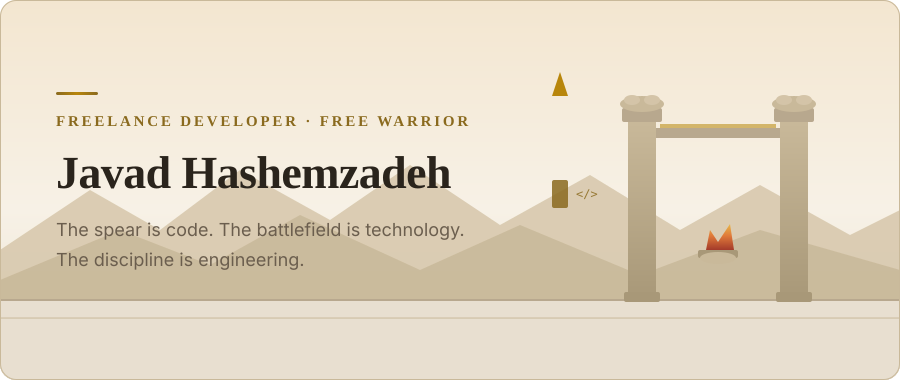
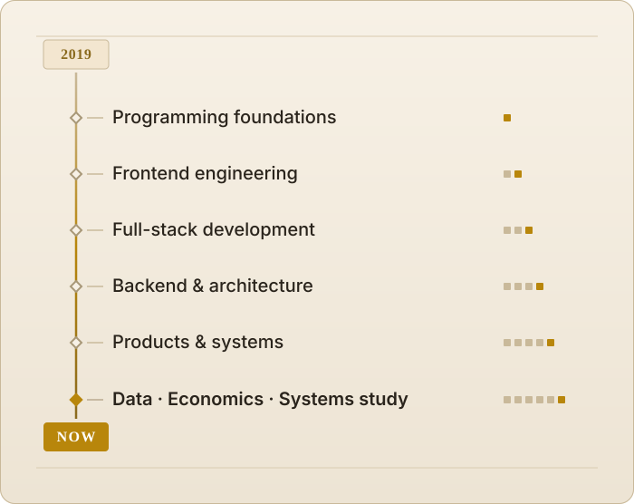

  

  <a href="https://javadhashemzadeh.ir"><b>Website</b></a>
  &nbsp;&nbsp;&nbsp;&nbsp;
  <a href="https://t.me/javadhashemzadehir"><b>Telegram</b></a>
  &nbsp;&nbsp;&nbsp;&nbsp;
  <a href="https://www.instagram.com/javadhashemzadeh.ir"><b>Instagram</b></a>
  &nbsp;&nbsp;&nbsp;&nbsp;
  <a href="https://github.com/javad-hashem"><b>GitHub</b></a>
  <!-- TODO: replace MOCK_LINKEDIN_URL with the real profile URL, then uncomment the next line -->
  <!-- &nbsp;&nbsp;&nbsp;&nbsp; <a href="MOCK_LINKEDIN_URL"><b>LinkedIn</b></a> -->

---

> Once, a free warrior carried his own spear and chose his own battles.

The spear is code. The battlefield is technology. The discipline is engineering.

  <picture>
    <source media="(prefers-color-scheme: dark)" srcset="assets/hero-dark.svg">
    
  </picture>

## ⚔️ About

I am Javad Hashemzadeh, an independent freelance software developer.

The work has been my own road since 2019. It started in frontend engineering, moved through full-stack product work, and grew into software architecture. Building something real enough to break changed the questions: where a system should live, what happens when it fails, and who pays for the decision six months from now.

I founded **[Jahat Digital](https://jahat.digital)**, a small team building web products, web applications, and the design and digital strategy around them. The aim is systems designed to remain useful and maintainable — where a technical choice and a business consequence are the same decision.

## 🗡️ Skills

Languages, frameworks, and infrastructure. Production tools are listed as such. Anything still being learned is marked **Study**.

### Blades

Languages.

`TypeScript` · `JavaScript` · `SQL`

### Armor

Frameworks and the libraries around them.

`React` · `Next.js` · `Node.js` · `NestJS` · `Express` · `Tailwind CSS` · `Material UI` · `Framer Motion` · `TanStack Query` · `Redux Toolkit` · `Zustand`

### Battlefield

Data, delivery, and the ground a system has to survive on.

`PostgreSQL` · `MySQL` · `MongoDB` · `Prisma` · `Drizzle ORM` · `Docker` · `Linux` · `GitHub Actions` · `Git` · `pnpm` · `REST APIs` · `WebSockets` · auth & authorization

### Study

Not production claims. An active learning track.

`Python` · statistics · ML foundations · economics · game theory

<b>Full engineering toolbox</b>

 

| Responsibility | Tools |
| :--- | :--- |
| Product engineering | React · Next.js · TypeScript · Tailwind CSS · Material UI · Framer Motion |
| State & data flow | TanStack Query · Redux Toolkit · Zustand |
| Backend systems | Node.js · NestJS · Express · REST APIs · WebSockets · auth & authorization |
| Data & persistence | PostgreSQL · MySQL · MongoDB · Prisma · Drizzle ORM |
| Infrastructure | Docker · GitHub Actions · Git · Linux · pnpm |
| **Study** | Python · statistics · ML foundations · economics · game theory |

## 🏛️ Projects

Projects are missions: a constraint, a system, and a result someone can rely on.

### Completed Missions

Web products owned end to end — interface, API, authentication, and the path to production as one job. Service boundaries that still hold when the requirements move.

### Current Quests

Product work where operability and correctness matter more than feature count. Backend reliability: queues, idempotency, and behavior under failure.

### Future Campaigns

Systems that model, infer, and decide, rather than only storing data and rendering it back. The study track above is the preparation for that work.

### 2019 → Present

  <picture>
    <source media="(prefers-color-scheme: dark)" srcset="assets/journey-dark.svg">
    
  </picture>

## 📜 Philosophy

A short code for work that has to outlast the person who shipped it.

**Build with purpose.** Every tool exists because something hurt. If I cannot name that pain, I am inheriting someone else's solution along with their problem.

**Keep learning.** The road from syntax to systems does not close. A new discipline is part of the craft.

**Share knowledge.** Clear code and notes a stranger can use. Mastery that cannot be handed on stays a private habit.

**Create systems that survive their creator.** Boring and understandable beats clever. Clear boundaries win, because the next reader has none of the context and all of the consequences.

Trade-offs are the actual work: consistency against latency, flexibility against a schema you can reason about, shipping now against maintaining later.

> A system is only as good as the assumptions it still lets you change.

## 🦅 Contact

**Website:** [javadhashemzadeh.ir](https://javadhashemzadeh.ir)

**Telegram:** [t.me/javadhashemzadehir](https://t.me/javadhashemzadehir)

**Instagram:** [javadhashemzadeh.ir](https://www.instagram.com/javadhashemzadeh.ir)

**Email:** [javadhashemzadeh78@gmail.com](mailto:javadhashemzadeh78@gmail.com)

**Phone:** [+98 937 067 8064](tel:+989370678064)

**GitHub:** [github.com/javad-hashem](https://github.com/javad-hashem)

<!-- TODO: add LinkedIn once MOCK_LINKEDIN_URL is a real profile URL -->

  Open to conversations about backend architecture, product engineering, and data-driven systems.

